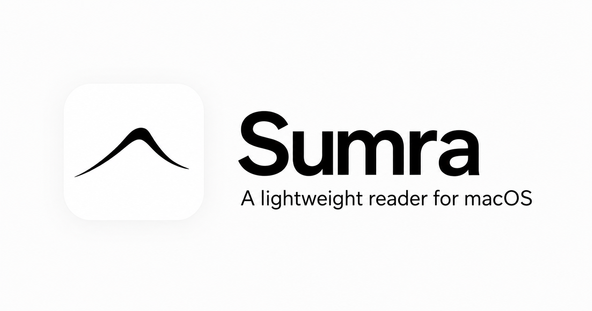
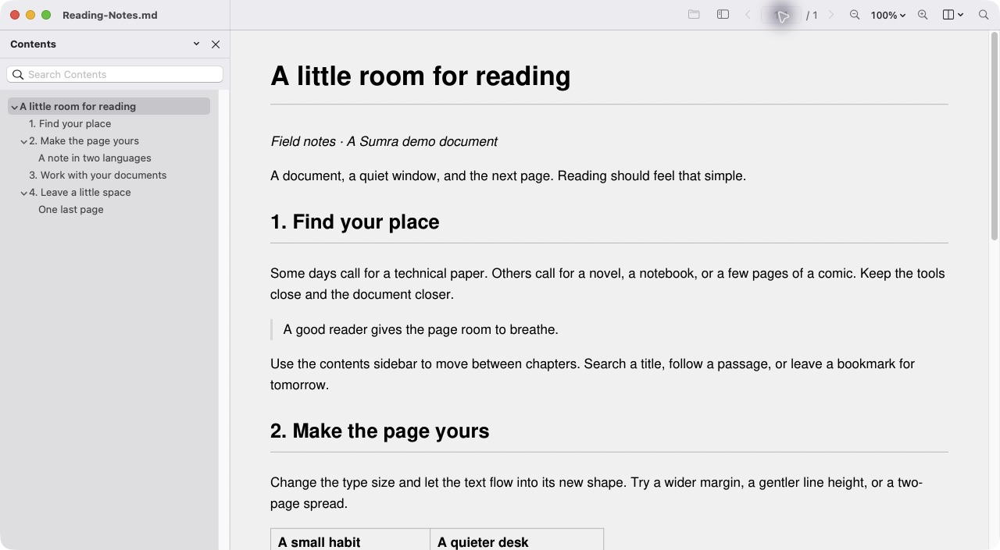
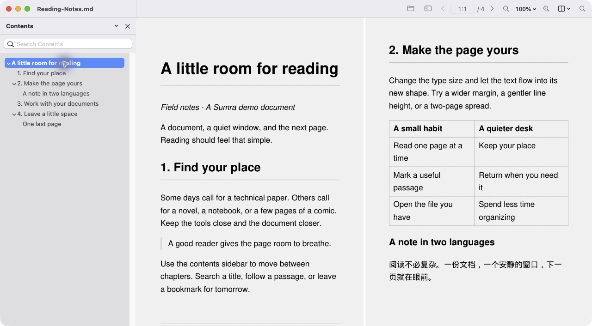
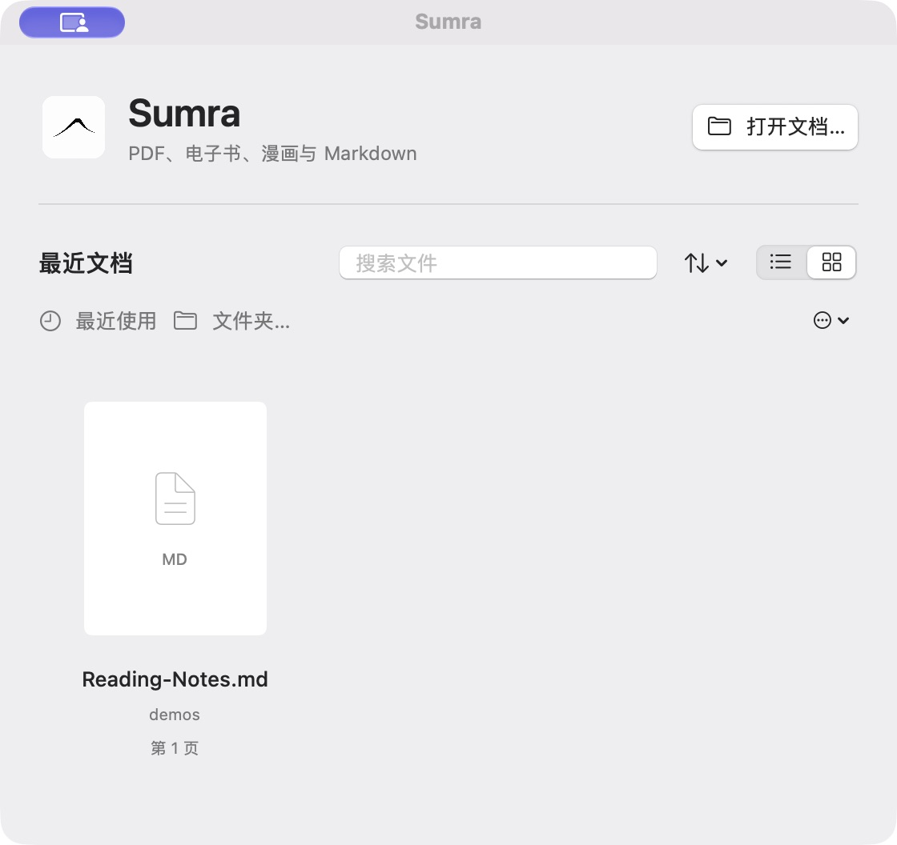
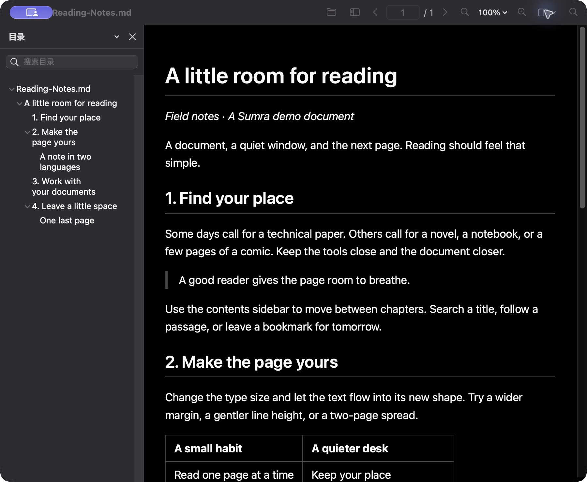
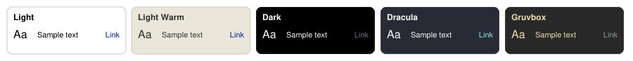

<p align="center">
  
</p>

# Sumra — 輕巧純粹的 macOS 閱讀器

**電子書、漫畫、PDF、圖片與 Markdown，一款原生 Mac App，專注閱讀。**

[English](README.md) · [简体中文](README.zh-CN.md) · **繁體中文** · [日本語](README.ja.md)

**macOS 13 以上版本 · Apple Silicon · 免費開源**

[**下載 Mac 版**](https://github.com/Ares-X/Sumra/releases/latest) · [版本資訊](https://github.com/Ares-X/Sumra/releases) · [支援格式](#支援的格式) · [從原始碼建置](#從原始碼建置) · [回報問題](https://github.com/Ares-X/Sumra/issues)

從 Finder 開啟 EPUB 小說、漫畫壓縮檔、圖片資料夾、Markdown 筆記或 PDF。在原生 Mac 視窗和分頁中閱讀，選擇合適的版面配置，再透過目錄、搜尋和書籤找到想看的內容。



<details>
<summary>更多截圖：雙頁閱讀、最近開啟的檔案與深色模式</summary>







所有截圖都使用儲存庫中的[原創示範文件](docs/demos/Reading-Notes.md)。

</details>

## 安裝並開始閱讀

1. 從[最新版本下載頁面](https://github.com/Ares-X/Sumra/releases/latest)下載 App ZIP 檔並解壓縮。
2. 將 **Sumra.app** 移至「**應用程式**」資料夾，然後開啟。
3. 按 **⌘O** 開啟檔案，或將檔案拖進視窗；按 **⌘F** 搜尋文件內容。

公開版本使用維護者的 **Ares-X Code Signing** 自簽憑證，並非 Apple Developer ID 憑證，也未經 Apple 公證。如果 macOS 阻擋首次開啟，而你確認下載來源可信，請依照 [Apple 的說明](https://support.apple.com/zh-tw/102445)，前往 **系統設定 → 隱私權與安全性 → 強制打開**，再確認開啟。

**更新：**選擇 **Help → 檢查是否有更新…**，或在 **Settings（設定）** 中啟用自動檢查。Sparkle 會驗證更新，並在你確認後安裝。每個版本也會附上相對應的原始碼與 SHA-256 校驗碼。

<details>
<summary>相容性與舊版安裝說明</summary>

發行版以 **Apple Silicon（arm64）** 為目標平台，最低系統目標為 **macOS 13**。打包時會檢查內附執行檔和程式庫的 arm64 支援、最低部署版本與執行階段相依項目。已在 macOS 27.0.1 上完成 GUI 驗收；尚未在 macOS 13 實機上驗證。

0.2.0 沒有更新來源，需手動安裝一次較新版本；0.2.1 及後續版本支援 App 內更新。PostScript 和 EPS 需要另外安裝 Ghostscript。

</details>

## 專為閱讀打造

- **原生視窗與分頁。**從 Finder 開啟、將檔案拖進 Sumra，或從首頁繼續閱讀。在 **Settings（設定）** 中啟用 **Use window tabs（使用視窗分頁）**，即可在同一個視窗中閱讀多本書。
- **適合文件的版面配置。**提供單頁、連續捲動和雙頁跨頁模式，並可調整主題與排版。可重排版電子書會配合視窗調整；固定版面則保留原有頁面配置。
- **快速找到閱讀位置。**提供目錄、章節標題搜尋、全文搜尋、縮圖、書籤，以及可選的閱讀位置記錄。若 TXT 和 MOBI 沒有作者編製的目錄，也能偵測獨立成行的章節標題。
- **瀏覽漫畫合集。**壓縮檔中的資料夾會成為目錄項目，並保留名稱與層級。適用的 solid LZMA2 壓縮檔可透過記憶體中的區段索引快速跳至較遠位置，不會修改原檔，也不會在磁碟上建立解壓後的書籍快取。
- **處理 PDF。**填寫表單、編輯註解、復原與重做、擷取或合併頁面，並儲存變更。PDF 編輯功能預設鎖定，選擇 **Enable Editing（啟用編輯）** 後才能使用。**Save a Copy…（儲存副本）** 會保留可編輯的表單與註解；**Export PDF…（匯出 PDF）** 則會建立靜態閱讀副本。
- **朗讀、列印與匯出。**使用系統語音朗讀全文或選取文字，透過 macOS 列印面板列印，或匯出 PDF。可用功能視檔案格式和文件權限而定。

使用側邊欄查看目錄、縮圖和書籤；透過 **View（檢視）** 選單調整版面配置與主題；在 **Settings（設定）** 中管理排版、歷史記錄和分頁。**Help → 鍵盤快速鍵** 會列出指令；你也可以在 Settings 中自訂快速鍵。

可選擇五種內建閱讀主題，也可自訂並儲存文字、背景和連結色彩。現有自訂主題與已儲存設定仍可繼續使用：



## 支援的格式

| 類型 | 格式 |
| --- | --- |
| PDF 與固定版面 | PDF、XPS / OXPS、SVG、DjVu |
| 電子書 | EPUB、MOBI、AZW、PRC、FB2 / 壓縮 FB2 |
| 漫畫與圖片 | CBZ、CBR、CB7、CBT、圖片資料夾；常見圖片格式，包括 GIF、TIFF 和 JPEG XL |
| 文字與網頁 | Markdown、HTML / XHTML、CHM、TXT 等純文字格式、TCR |
| 其他相容格式 | PDF 相容的 AI、P7M 封裝檔、LIT |
| 需要額外軟體 | PostScript / EPS：請另外安裝 Ghostscript |

支援情況會因檔案變體而異。Sumra 不提供 OCR 或 DRM 移除功能；掃描頁面必須已有文字層，才能搜尋文字。

<details>
<summary>顯示方式與格式限制</summary>

- Markdown 使用 MuPDF，也可選擇 WebKit 相容模式。HTML 和 CHM 使用 WebKit 閱讀；列印和匯出 PDF 則使用 MuPDF 排版，結果可能與閱讀畫面不同。
- 可重排版電子書和原生 Markdown 會精簡一般正文中重複的空白行與空段落，同時保留預先格式化的文字、表格、圖片區塊和明確的分頁。辨識出的 CHM 正文也會採用較緊湊的段落間距；調整字型、大小或行距會覆蓋出版者樣式。
- PDF 中的黑白文字掃描頁面會自動增強對比。若要查看原始外觀，請在 **View → Document Colors（文件顏色）** 中關閉 **增強掃描頁面**。原始檔案不會變更。
- 區段索引可略過適用漫畫壓縮檔中較早的獨立區段。第一次跳轉仍需解碼目標區段內前面的資料，因此並非每個尚未讀取的位置都能立即開啟。

詳情請參閱[格式與引擎支援範圍](docs/SUMATRA_ENGINE_PARITY.md)、[Markdown 顯示方式](docs/MARKDOWN_RENDERER_DECISION.md)和[漫畫區段跳轉](docs/COMIC_SEEK_INDEX_20261020.md)。

</details>

## 從原始碼建置

需要 macOS、Apple Swift 工具鏈與 macOS SDK，以及 CMake。首次建置需要網路連線，以取得固定版本的原生相依項目和 Sparkle。專案建置與封裝腳本使用 Swift 和系統工具，不需要 Python。

```sh
git clone https://github.com/Ares-X/Sumra.git
cd Sumra
./scripts/build-app.sh --release
open dist/Sumra.app
```

如需安裝 CMake，可使用你的套件管理工具，例如 `brew install cmake`。若要建置並啟動開發版本，請使用 `./scripts/run-dev.sh`。本機建置預設採用 ad-hoc 簽署。

Sumra 是圖形介面應用程式；開啟檔案、使用文件工具和列印都透過介面操作。開發資訊請參閱[實作說明](docs/IMPLEMENTATION_STATUS.md)、[本機檢查](scripts/check-source.sh)和[發布流程](docs/RELEASE_ACTIONS.md)。

## 參與貢獻與翻譯

歡迎[回報錯誤、提出功能建議](https://github.com/Ares-X/Sumra/issues)和提交 Pull Request。回報時請盡可能附上 macOS 與 Sumra 版本、檔案格式、重現步驟，以及可分享的範例檔案。

README 提供英文、簡體中文、繁體中文和日文版本。請以 [README.md](README.md) 為內容參考，維持相同的章節順序，並在共通資訊變更時更新其他語言版本。所有版本共用相同的截圖，並連結至技術文件。

## 授權與致謝

Sumra 新增的程式碼採用 **[AGPL-3.0-or-later](LICENSE)** 授權。上游及移植的元件保留各自的授權與著作權聲明；來源、版本和授權資訊請參閱 [THIRD_PARTY.md](THIRD_PARTY.md)。

Sumra 的設計受到 [SumatraPDF](https://github.com/sumatrapdfreader/sumatrapdf) 啟發，沿用 MuPDF 和 SumatraPDF 的部分文件處理程式，並以 SwiftUI 和 AppKit 打造介面。感謝 [MuPDF](https://mupdf.com/) 及其他上游專案。Sumra 為獨立開發；功能涵蓋範圍與尚存差異請參閱[對照說明](docs/SUMATRA_PARITY.md)。
